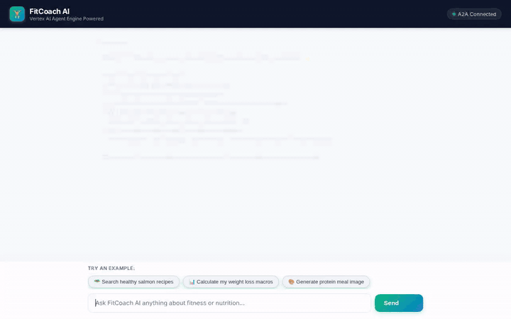

# 🏋️ FitCoach AI

FitCoach AI is an intelligent fitness and nutrition assistant built with the **Google Agent Development Kit (ADK 1.1.0)**, **Gemini**, and **Vertex AI Agent Platform**. It helps users track daily meals and exercises, discover healthy recipes, calculate metabolic macro targets, generate meal visuals, and remember personal preferences across sessions.



---

## ✨ Features & Capabilities

FitCoach AI is backed by specialized tool implementations, database integrations, and multimodal AI services:

- 🥗 **Live Recipe Discovery (`search_recipe_ideas`)**: Queries **TheMealDB** API to find healthy meal ideas, ingredient lists, and cooking details.
- 🏋️ **Workout Catalog Search (`get_workouts`)**: Queries **Cloud Firestore** (`workouts` collection) to filter workout routines by category (HIIT, Strength, Cardio, Flexibility).
- 📝 **Daily Activity & Net Calorie Tracker (`log_activity`, `get_daily_summary`)**: Logs meals and workouts to **Cloud Firestore** (`daily_logs` collection), tracking consumed calories, burned calories, and net energy balance per user.
- 📊 **Metabolic & Macro Calculator (`calculate_macronutrients`)**: Calculates BMR (Mifflin-St Jeor), TDEE, daily target calories, and macro splits (Protein, Carbs, Fats) tailored to weight loss, maintenance, or muscle gain.
- 🔥 **Exercise Burn Estimator (`estimate_workout_calories`)**: Estimates calorie burn using Metabolic Equivalent of Task (MET) ratings for running, swimming, cycling, weightlifting, HIIT, walking, and yoga.
- 🎨 **Multimodal Image Generation (`generate_item_image`)**: Generates custom meal and workout images using **Vertex AI `gemini-3.1-flash-lite-image`**, saves local ADK artifacts, and uploads public image assets to **Google Cloud Storage (GCS)**.
- 🧠 **Cross-Session Long-Term Memory**: Integrates `PreloadMemoryTool` and `VertexAiMemoryBankService` to recall user allergies, dietary restrictions, workout history, and progress across sessions.
- 🎴 **Rich Card Display (A2UI v0.8)**: Uses `A2uiSchemaManager` and `BasicCatalog` (`a2ui_callback`) to render rich UI cards for recipe results and workout plans.
- 💻 **Python Code Execution Sandbox**: Uses `AgentEngineSandboxCodeExecutor` for secure data calculations and fitness metrics analysis.

### 📋 Planned Capabilities (Not Yet Implemented)
- ⌚ **Wearable & Smartwatch Sync** (Fitbit / Apple Health sync) — *Planned, not yet implemented*.
- 📸 **Barcode Packaging Scanner** — *Planned, not yet implemented*.

---

## ☁️ Google Cloud Infrastructure

FitCoach AI connects directly to the following Google Cloud services:

| Service | Role in FitCoach AI |
|---|---|
| **Vertex AI Agent Engine / Reasoning Engine** | Serverless agent runtime deployment target (A2A protocol). |
| **Vertex AI Memory Bank** | Long-term memory extraction and recall service. |
| **Vertex AI Imagen (`gemini-3.1-flash-lite-image`)** | Generates high-quality meal and exercise imagery. |
| **Cloud Firestore** | Stores workout catalog collections (`workouts`) and user daily logs (`daily_logs`). |
| **Google Cloud Storage (GCS)** | Public bucket hosting generated meal and workout image files. |
| **Cloud Run** | Serverless container service hosting the FastAPI A2A proxy and chat UI. |

---

## 🛠️ Project Structure

```text
fitcoach-ai/
├── app/
│   ├── agent.py            # ADK agent definition, function tools, memory & image generation
│   ├── a2ui_utils.py       # A2UI v0.8 schema manager and after_model_callback
│   └── fast_api_app.py     # FastAPI agent application server
├── frontend/
│   ├── main.py             # FastAPI proxy connecting browser to Agent Engine over A2A
│   ├── static/index.html   # Responsive chat UI with example prompts & A2UI renderer
│   ├── Dockerfile          # Container specification for Cloud Run deployment
│   └── requirements.txt    # Frontend proxy dependencies
├── seed_database.py        # Script to seed Firestore workouts catalog
├── agents-cli-manifest.yaml# Agent project manifest and metadata
├── demo.gif                # Looping demonstration recording
├── GEMINI.md               # Antigravity agent development guidelines
└── pyproject.toml          # Project dependencies (ADK, Google GenAI SDK, Google Cloud libraries)
```

---

## 🚀 Local Setup & Running Instructions

### 1. Prerequisites
- Python 3.11+
- [uv](https://docs.astral.sh/uv/) package manager
- `google-agents-cli` (`uv tool install google-agents-cli`)
- Google Cloud SDK authenticated with a GCP project ID

### 2. Environment Variables
Create or verify your `.env` file in the project root:

```bash
GOOGLE_CLOUD_PROJECT="your-gcp-project-id"
GOOGLE_CLOUD_LOCATION="us-east1"
THEMEALDB_API_KEY="1"
```

### 3. Install Dependencies
```bash
uv sync
```

### 4. Run the Agent Locally (ADK Web Playground)
To start the ADK playground with Vertex AI Memory Bank connected:

```bash
uv run adk web . --port 8080 --reload_agents --memory_service_uri=agentengine://<YOUR_MEMORY_BANK_ID>
```

### 5. Run the Custom Frontend Proxy Locally
In a separate terminal window:

```bash
cd frontend
pip install -r requirements.txt
export AGENT_ENGINE_RESOURCE_NAME="projects/<PROJECT_ID>/locations/us-east1/reasoningEngines/<ENGINE_ID>"
export AGENT_DIRECTORY="app"
python main.py
```

---

## 🚢 Deployment Instructions

### Deploy Agent to Agent Platform
Deploy the reasoning engine using `agents-cli`:

```bash
gcloud config set project <YOUR_PROJECT_ID>
agents-cli deploy --update-env-vars THEMEALDB_API_KEY=1
```

### Deploy Frontend Proxy to Cloud Run
Build and ship the frontend container:

```bash
cd frontend
gcloud run deploy fitcoach-frontend \
  --source . \
  --region us-east1 \
  --allow-unauthenticated \
  --set-env-vars AGENT_ENGINE_RESOURCE_NAME="projects/<PROJECT_ID>/locations/us-east1/reasoningEngines/<ENGINE_ID>",AGENT_DIRECTORY="app"
```

---

## 📄 License

This project is licensed under the Apache 2.0 License.
